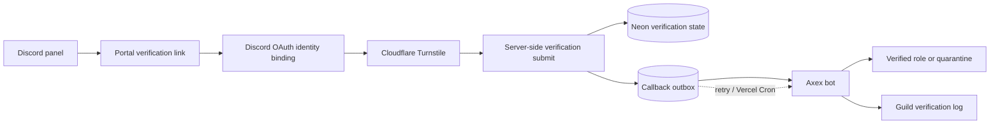

# Axex Guardian Portal

Discord bot verification portal for the Axex security bot.

## Verification flow



## Stack

React, Tailwind CSS, TanStack Start, Neon Postgres, and Drizzle ORM.

## Local development

1. Install dependencies with `npm install`.
2. Copy `.env.example` to `.env` and fill in the values.
3. Start the development server with `npm run dev`.
4. To preview the verification experience without a Discord bot or database token, open `http://localhost:5173/verify?demo=1`.

For local development, apply the Drizzle schema with `npm run db:push` when using a new Neon database. Production schema changes use the ordered SQL migrations in `drizzle/`; apply them with `npm run db:migrate` before deploying the matching application version.

## Production deployment

The app produces a standard Node-compatible build and does not depend on Render-specific runtime behavior.

### Vercel

The GitHub repository is linked to the Vercel project. Vercel can use the default settings:

- **Framework preset:** Vite
- **Build command:** `npm run build`
- **Install command:** `npm install`
- **Production branch:** `main`

Add the environment variables below to the Vercel project before using OAuth, verification, or bot APIs. Keep server-only values unprefixed; never expose them as `VITE_*` variables.

### Any Node host

```sh
npm install
npm run build
PORT=3000 HOST=0.0.0.0 node server.mjs
```

The `start` script runs the same production server after building:

```sh
npm start
```

### Docker

```sh
docker build -t axex-guardian-portal .
docker run --env-file .env -p 3000:3000 axex-guardian-portal
```

The container listens on `0.0.0.0:$PORT` and can run on any Docker-compatible host.

## Environment variables

- `DATABASE_URL`
- `DISCORD_CLIENT_ID`
- `DISCORD_CLIENT_SECRET`
- `DISCORD_REDIRECT_URI` — set this to `https://your-domain.example/api/auth/callback` in production.
- `PROXYCHECK_API_KEY`
- `ALLOW_LOCALHOST_NETWORK_CHECK=false` — local development only; do not enable in production.
- `TRUSTED_PROXY_MODE=vercel` on Vercel, `cloudflare` only when requests are guaranteed to pass through Cloudflare, or `none` when no trusted proxy is configured.
- `CRON_SECRET` — server-only bearer secret used by the Vercel Cron fallback for `/api/bot/outbox`.
- `TOKEN_RETENTION_DAYS=30` — token retention for the scheduled cleanup. Verification state and active locks are not removed.
- `AUDIT_LOG_RETENTION_DAYS=365` — audit-log retention for the scheduled cleanup.
- `OUTBOX_RETENTION_DAYS=30` — retention for delivered callback payloads only; pending/processing callbacks are preserved.
- `BOT_TO_PORTAL_KEY` — key for bot requests to portal APIs.
- `PORTAL_TO_BOT_KEY` — key for portal callbacks to the bot.
- `AXEX_BOT_API_KEY` — deprecated one-release fallback for either direction; rotate to the directional keys.
- `BOT_WEBHOOK_URL` — server-only bot verification-result receiver. Use HTTPS in production; the server warns if this is configured with plain HTTP.
- `INTELLIGENCE_URL` — server-only account intelligence API base URL.
- `INTELLIGENCE_API_KEY` — server-only account intelligence API key.

After changing the deployment domain, update the Discord OAuth redirect URL in the Discord application as well as `DISCORD_REDIRECT_URI`.

The bot should poll `/api/bot/outbox` every 20–30 seconds using the `x-api-key` header. Vercel Cron is a fallback; Hobby plans support daily cron schedules only, so the bot poll is the reliable delivery path. The portal also attempts delivery immediately after recording a terminal verification result. The authenticated Cron request also runs retention cleanup: tokens default to 30 days, audit logs to 365 days, and verification state (including locks) is retained until a release. Apply the additive SQL migrations in `drizzle/` using the Drizzle migration journal before deploying a schema-dependent application version.

Rotate the bot/portal key by setting `BOT_TO_PORTAL_KEY` and `PORTAL_TO_BOT_KEY` in the portal and the matching directional keys in the bot first. Keep `AXEX_BOT_API_KEY` configured only during the one-release compatibility window, verify the bot poll and callbacks, then remove the legacy variable and rotate the Cron secret separately.

The additive schema migrations can remain applied during an application rollback. Migration `0006` adds independent limiter/cache tables and outbox alert metadata; it may be reversed only after deploying code that no longer reads those additions. Migration `0007` corrects exhausted legacy attempts into locks and is intentionally forward-only; do not clear those locks as part of a code rollback—release users through the authenticated bot flow.

Apply migrations and validate the production environment in staging before rollout. Keep directional API keys synchronized with the bot and preserve durable verification locks during rollback.
